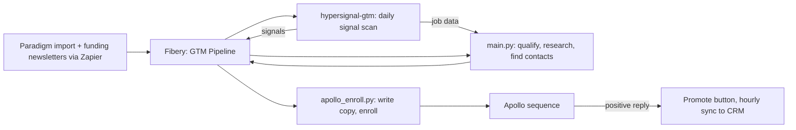

# Signal-Driven Outbound

An outbound system I built to spot companies the moment they start hiring in NYC, reach the right people with a researched email, and keep my CRM clean while it runs. Built for NYCbound, the B2B relocation program at Pinpointe Group.

## Results

- **$450K in direct customer pipeline sourced from this system's outbound**, out of $580K total direct pipeline ($1.2M including channel partners)
- **4% reply rate**
- About $0.16 in estimated AI spend per enrolled contact

## What it does

Every weekday at 1pm, with no one touching it:

1. **Watches ~1,500 target companies** for hiring, funding and growth signals, using [hypersignal-gtm](https://github.com/rachel-pinpointe/hypersignal-gtm)
2. **Qualifies them** against the ICP: open NYC roles, not remote, and pay at $150K+ wherever it's listed
3. **Finds the right people** across three personas (People Ops, Finance, Recruiting) through a data waterfall that stops paying the moment it has an email
4. **Researches each company's stated goals** and writes a fully custom 3-email sequence per contact, grounded in that persona's play
5. **Enrolls them in Apollo** and writes status back to Fibery
6. **One click queues a good reply** for the CRM, and an hourly job moves it over. Nobody who hasn't replied ever touches it.

## Architecture



## The calls that made it work

**Guards before volume.** Every contact passes a 60-day gate, a check for recent activity in Apollo, including anything synced from my mailbox, and an email-validity check. Enrollment is capped at 25 companies a day to protect a single sending mailbox.

**Don't trust a 200.** Apollo sometimes accepts an enrollment and silently drops the contact. The system re-fetches every contact afterward and only counts it if the sequence actually shows up.

**Free first, paid last.** Research and contact discovery run through free and cached sources before any paid lookup, and every AI call is logged by purpose and cost.

**Staged rollout.** One contact, then one company, then a handful, then unattended. I read the real sent copy at every stage and fixed what I found before turning volume up.

**Every bug gets a test.** 378 tests. Several pin real failures from live runs.

## What I'd build next

- Move it off my laptop onto always-on hosting
- A hard daily ceiling on AI spend
- Better hiring coverage. Most companies still lack fresh job data because the main source rate-limits. The next step was finding each company's job board directly.

## Stack

Python, Claude (Anthropic API), Apollo, Fibery, String, QuickEnrich, Hunter, Scrubby, Exa, Jina, macOS launchd. Built with Claude Code.

## Running it

This is a snapshot of a live system, wired to my own accounts: the Fibery workspace and its field IDs
(`src/fibery_client.py`), and the Apollo sequence and custom-field IDs (`src/apollo_enroll.py`). The
tests run anywhere. A real run needs those accounts, or those IDs changed to point at yours.

### Setup

```bash
python3 -m venv .venv && source .venv/bin/activate
pip install -r requirements.txt
```

Keys go in `.env` at the repo root:

| Variable | Used for |
|---|---|
| `ANTHROPIC_API_KEY`, `ANTHROPIC_MODEL` | Stated-goal research, Likely Priorities, email copy, the preflight check |
| `STRING_API_KEY`, `QUICKENRICH_API_KEY`, `APOLLO_API_KEY`, `HUNTER_API_KEY` | Required by `main.py`, which refuses to start without them |
| `FIBERY_API_TOKEN` | Every Fibery read and write |
| `SCRUBBY_API_KEY` | Only with `main.py --scrub` |
| `EXA_API_KEY` | Second search index when web search finds no stated goal |
| `JINA_API_KEY` | Optional; raises Jina's free-tier rate limit |

### Tests

```bash
python -m unittest discover -s tests -t .   # 378 tests, no network, no API keys
```

### The daily run

The weekday 1pm launchd job runs these steps in order. Its driver script, `run-cron.sh`, lives in
[hypersignal-gtm](https://github.com/rachel-pinpointe/hypersignal-gtm).

```bash
python src/sync_watchlist.py                      # pick today's batch of domains from Fibery
#   hypersignal: job fetch + company signal scan   (separate repo)
python src/sync_watchlist.py --commit-rotation    # advance the rotation once the fetch is done
python src/signal_ingest.py                       # new signals from signals.db -> Fibery
python -m src.preflight_anthropic                 # one cheap call; aborts the run if the API is down
python -m src.main --input fibery                 # qualify, research, find contacts, write back
python -m src.apollo_enroll                       # generate copy, enroll in Apollo
```

### main.py

```bash
python -m src.main --input fibery            # active companies, live from Fibery
python -m src.main --input companies.csv     # or a CSV with a company-name column and a URL column
```

| Flag | Effect |
|---|---|
| `--dry-run` | Free rungs only: no paid email lookups, no LLM calls, no Fibery writes |
| `--redact` | Masks contact names, emails and LinkedIn slugs in terminal output; company names stay visible |
| `--estimate` | Prints a cost estimate and exits; spends nothing |
| `--limit N` / `--company NAME` | Only the first N companies / one company by exact name |
| `--persona KEY` | One persona only: `cfo`, `hr_people_ops` or `recruiter_ta` |
| `--daily-cap N` | Companies entering research per day (default 25; dry runs exempt) |
| `--max-credits N` | Override the built-in QuickEnrich credit cap |
| `--enrich-all` | Find contacts at disqualified companies too |
| `--no-cache` | Bypass the cache and refetch everything |
| `--scrub` / `--scrubby-budget N` | Verify Apollo/Hunter emails with Scrubby before output (default budget 200) |
| `--outdir DIR` | Where the `leads_*.csv` files go (default `outputs`) |

### apollo_enroll.py

```bash
python -m src.apollo_enroll --dry-run --redact   # safe demo: real reads and copy, no writes, masked output
```

| Flag | Effect |
|---|---|
| `--dry-run` | Runs every stage (Fibery and Apollo reads, guards, copy generation) but skips Apollo enrollment and all Fibery writes. Each skipped write is printed as a `would:` line |
| `--redact` | Masks contact names, emails and LinkedIn slugs in terminal output; company names stay visible |
| `--limit N` | Only the first N eligible contacts (for testing) |

`--dry-run` means something different in each script. In `main.py` it skips anything paid. In
`apollo_enroll.py` it skips anything that writes.

### Other scripts

```bash
python src/paradigm_import.py export.csv [--dry-run]   # Paradigm export -> Fibery Companies, deduped against the CRM
python src/promote_to_crm.py [--dry-run]               # process "Promote to CRM" clicks into CRM Accounts/Contacts
python -m src.requalify_quarantined [--apply]          # clear cached research for quarantined domains
```
